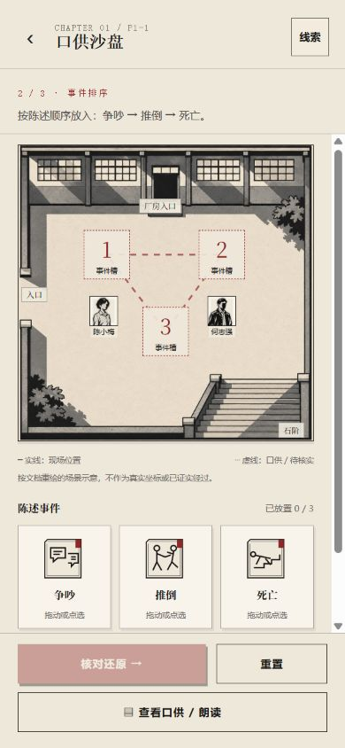

# 大馆密档 · UI Design Process

结合美术组已有素材与资产，补全 UI 和解谜美术，并借助 AI 产出适配技术组微信小程序开发环境的基础交互代码。

## 每周工作与主要产出

[查看完整工作总结与每周记录](weekly-review/README.md)

- 10月12—18日：流程分析、视觉探索与地图适配。
- 10月26日—11月1日：地图流程重构、策划反馈、技术交接与内容核对。
- 11月2—8日：第一章玩法、图标与证词交互优化。
- 11月9—15日：第二至第四章高保真 UI、交互整合与素材适配（记录截至11月12日）。

[下载精简产出包（约30MB）](deliverables/tai-kwun-weekly-work-20261114.zip)

包含8个主要版本包与16张代表性图片。具体版本及用途见每周记录。

## 工作流

核对交互需求与技术约束 → 复用美术组已有资产 → 确定手机布局 → 补全 UI 与解谜素材 → AI 辅助实现基础交互 → 检查并迭代 → 按点位整理素材、代码与交付包。

我的职责覆盖需求表达、素材补全与适配、视觉和交互判断、迭代反馈及交付整理；AI 辅助代码与素材制作。

## 最新原型片段——剧情中的解密模拟

  

人物放置 → 事件排序 → 待核实信息；人影标记 → 证词含义判断 → 线索入档。
## 历史过程

[早期按日期整理的阶段记录](timeline/) · [历史主题记录](docs/)

历史阶段为回顾整理，当前每周工作总结已结合本人检查反馈更新。

