# 大馆密档 · UI Design Process

结合美术组已有素材与资产，补全 UI 和解谜美术，并借助 AI 产出适配技术组微信小程序开发环境的基础交互代码。

## 项目简介

《大馆密档》（Tai Kwun Files）是一个以香港大馆为实地探索场景、以1993年香港案件为叙事背景的 AR 导览解谜微信小程序项目。玩家扮演法援律师程日安，跟随地图寻找调查点位，通过现场扫描、角色对话、材料查阅和解谜逐步核实案件，体验一段与场馆空间结合的调查故事。

项目由四章调查内容组成：从口供与目击证词出发，梳理人物关系和行踪，再核对医学材料、认罪动机与更正证词，推进到案卷复核及法庭收尾。地图导航、任务进度、剧情、解谜、档案和设置共同构成完整 UI 体验。

**基本体验流程：进入案件 → 地图找点 → 现场指引与扫描 → 剧情对话 → 解谜与材料核查 → 线索归档 → 下一调查点。**

## 我的职责：全项目 UI 设计与制作

**本项目的 UI 设计与制作由我负责，覆盖主 Demo 的通用页面与四个章节的交互页面。** 美术组提供人物设定、场景等已有资产，我在其视觉风格基础上补全和适配 UI、解谜过程中需要的美术资源，并借助 AI 制作高保真页面及基础交互代码，整理、转换到技术组的微信小程序开发环境中。

- 通用 UI：案件入口、引导、地图、任务、地点指引、扫描、剧情、档案、设置与状态反馈。
- 四章交互 UI：口供沙盘、证词核查、人物关系、行踪材料、医学资料、会谈判断、案卷盖章及结局收录。
- 制作与交接：素材复用和补齐、角色与场景适配、手机单屏布局、资源压缩、交互迭代与代码打包。

## 工作流

我负责梳理交互所需资产，复用、适配正式人物和场景，补充 UI 与解谜资源，制作高保真页面与基础交互代码，并按点位整理素材、版本和交付包。技术组继续负责项目环境中的接入与后续工程开发。

**核对交互文档与技术约束 → 盘点已有资产 → 固定手机视口、规划布局 → 补全与压缩素材 → AI 辅助实现交互 → 逐屏检查和反馈 → 打包并适配微信小程序开发工具。**

## Demo 页面与四章交互过程

以下为实际制作过程截图，并非重新绘制的概念图。不同截图对应不同版本节点；主 Demo 导航与各章独立交互分别展示。

### 主 Demo · 完整通用页面

以下九页展示我负责的主 UI 系统。截图取自 V4.1 历史画板，呈现页面布局和视觉设计；案情文字与任务配置随后继续依据文档迭代。扫描画面为演示 UI。

<table><tr><th>案件入口</th><th>首次引导</th><th>调查地图</th></tr><tr><td>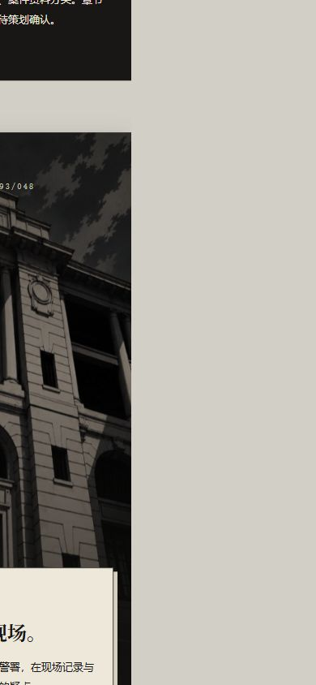</td><td>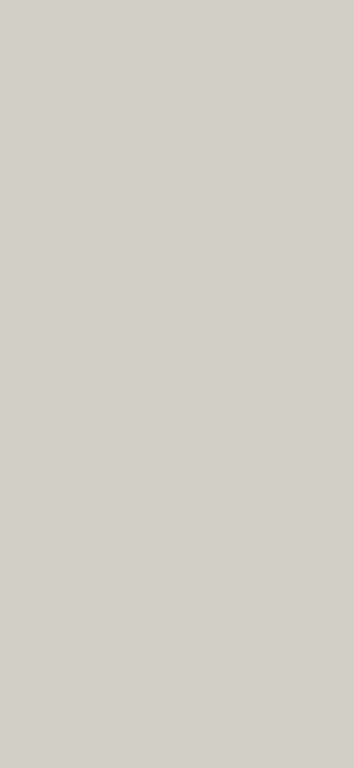</td><td>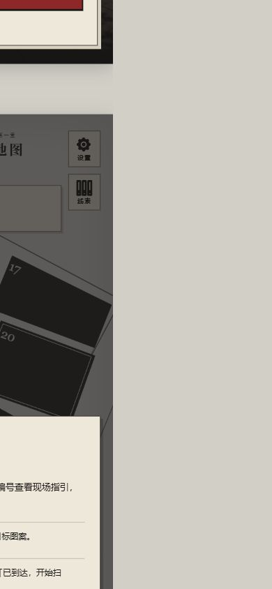</td></tr></table>

<table><tr><th>任务清单</th><th>地点与扫描指引</th><th>扫描界面</th></tr><tr><td>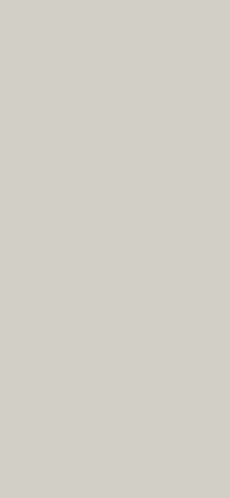</td><td>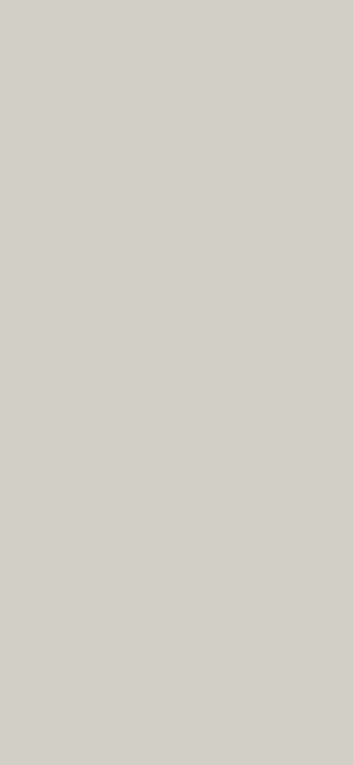</td><td>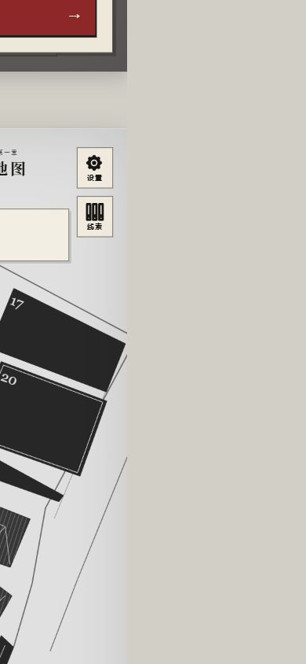</td></tr></table>

<table><tr><th>现场剧情</th><th>分类档案</th><th>设置与帮助</th></tr><tr><td>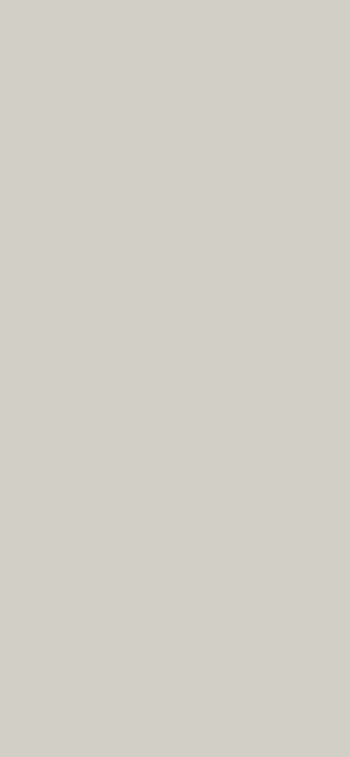</td><td>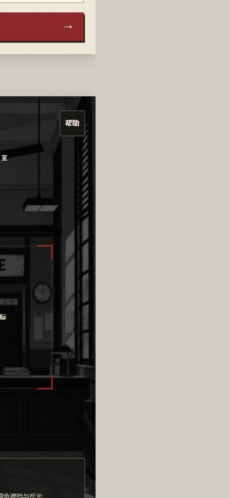</td><td>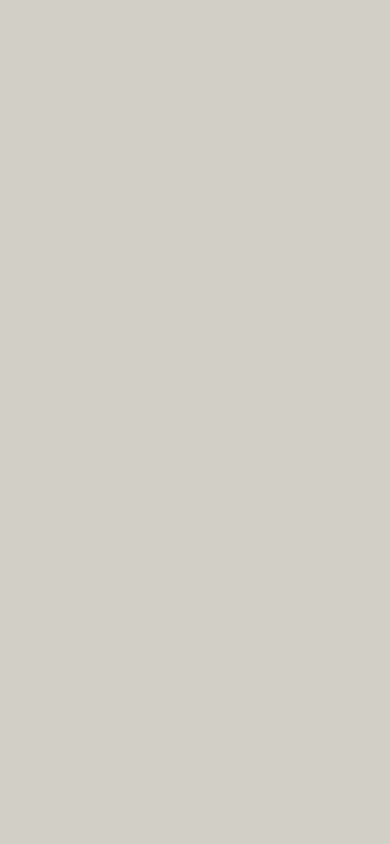</td></tr></table>

### 第一章 · 口供沙盘与证词核查

人物放置 → 事件排序 → 目击证词判断。将剧本信息转为操作，并区分观察与推论。

<table><tr><th>人物放置</th><th>事件排序</th><th>证词含义判断</th></tr><tr><td>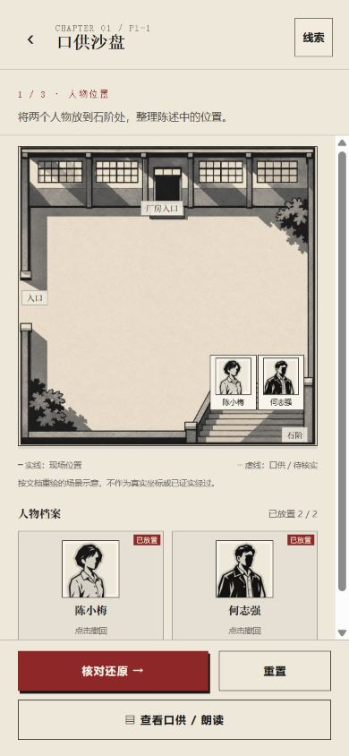</td><td></td><td>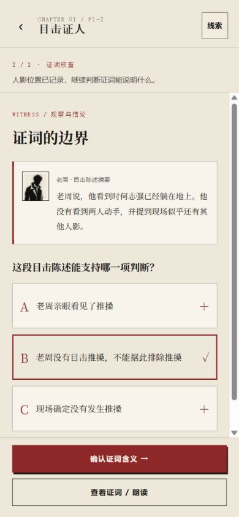</td></tr></table>

### 第二章 · 对话、人物关系与时间核查

从证词排序与复杂时间轴探索，调整为对白推进、关系标注与轻量材料核查。以下选用后期整合过程截图。

<table><tr><th>老周证词对白</th><th>人物关系标注</th><th>行踪材料核查</th></tr><tr><td>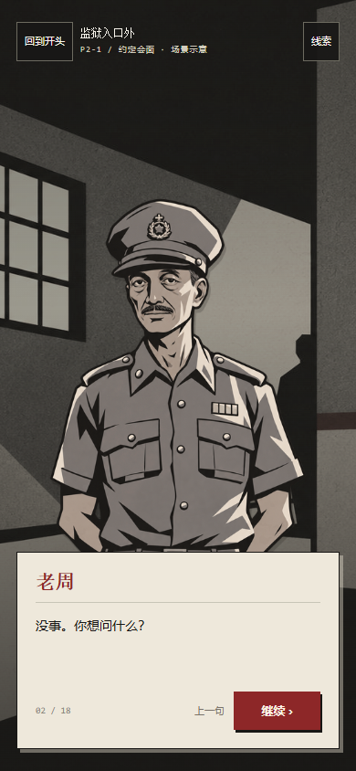</td><td>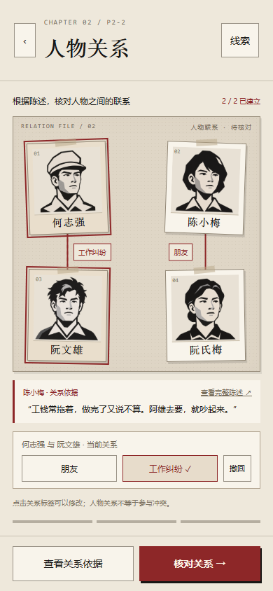</td><td>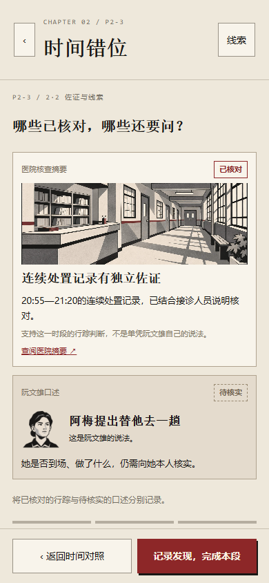</td></tr></table>

### 第三章 · 医学材料、会谈与认罪动机

阅读医学材料 → 律师追问与思考 → 结合会谈判断动机。删去重复对照与中转反馈，增加角色表情和明确的继续入口。

<table><tr><th>医学材料呈现</th><th>律师会谈与表情</th><th>会谈摘录与动机判断</th></tr><tr><td>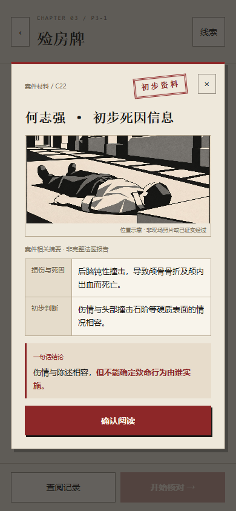</td><td>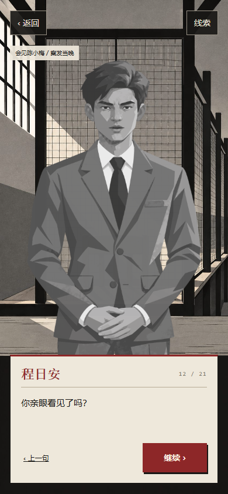</td><td>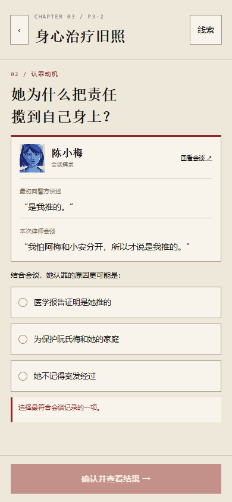</td></tr></table>

### 第四章 · 更正证词、案卷修订与法庭收尾

证词更正 → 三条案卷盖章判断 → 归档 → 法庭对白。保留关键揭示与盖章效果，取消普通对白的多余动画。图片为对应功能的迭代节点。

<table><tr><th>证词更正揭示</th><th>纸质案卷盖章</th><th>P4-2 法庭对白</th></tr><tr><td>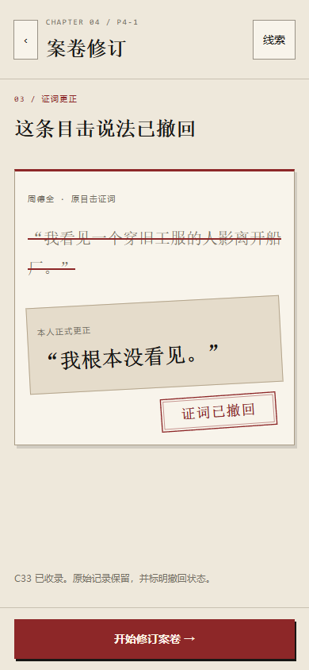</td><td>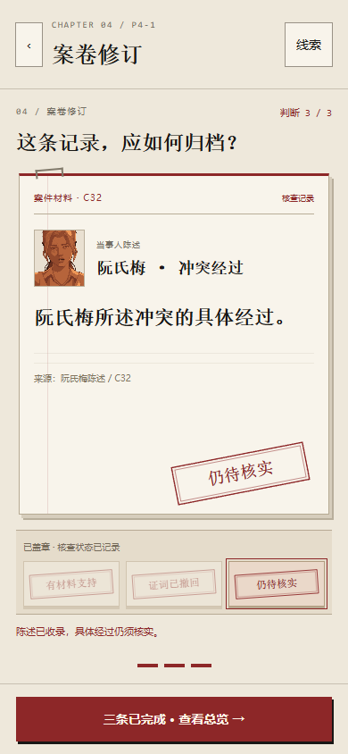</td><td>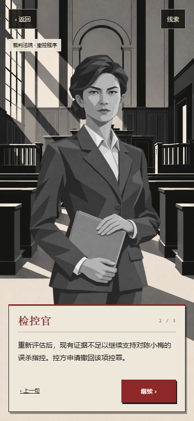</td></tr></table>

## 每周做了什么、更新了什么

| 周期 | 主要工作 | 主要修改与交付 |
| --- | --- | --- |
| 10月12—18日 | 原型流程分析、四种视觉探索、浮层与地图适配 | 按美术组风格制作 UI；修正手机尺寸；实现地图铺满、整图拖动与缩放，完成早期 Demo。 |
| 10月26日—11月1日 | 地图核心流程、策划反馈、技术交接 | 分开地图位置、任务清单与扫描入口；线索恢复分类档案；统一色值和完成印章；核对网页/小程序版本与正式剧情资料。 |
| 11月2—8日 | 第一章玩法及资产补全 | 人物头像拖拽、事件排序、证词判断；依据个人草图调整事件图标；修复显示问题，交付两个模块独立包。 |
| 11月9—15日（记录截至12日） | 第二至第四章高保真 UI 与交互整合 | 按前端要求重排手机单屏布局，控制图片150—250KB；简化重复阅读与无意义操作；补人物表情、材料、背景和案卷 UI；完成文档要求的交互并打包转换到微信小程序开发工具。 |

## 关键设计判断

- 每一屏先明确要让玩家理解什么，避免重复得出已知结论。
- 复用美术组正式角色设定，补充资源须与项目画风一致。
- 布局先于素材制作，减少滚动、重复框层和无效中转。
- 区分事实与推论，按文档纠正 AI 生成的无依据内容。
- 对白保持克制，只在更正揭示、结论和盖章等必要位置强调反馈。

## 主要交付与详细记录

- [完整每周工作记录与各阶段文件](weekly-review/README.md)
- [下载精简产出包（约30MB，8个主要版本包＋代表性图片）](deliverables/tai-kwun-weekly-work-20261114.zip)
- [早期按日期归档的阶段记录](timeline/)

以上为工作过程的回顾整理；个人贡献与范围已结合本人检查反馈更新。
