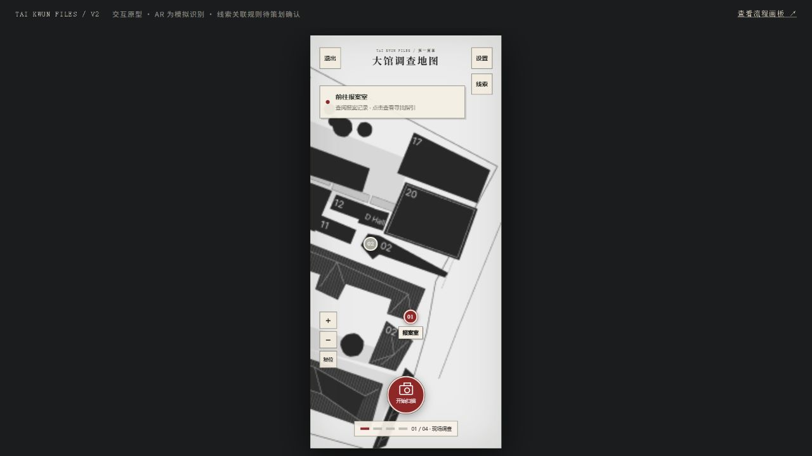
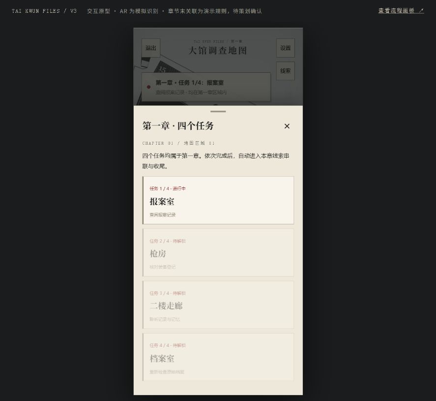

# 01 · 需求与导航

## 目标
将实地解谜中的地图、任务、地点指引、剧情与档案组织为可以体验的手机流程。

## 需求转译
地图首页需要让玩家知道当前任务，并能进入地点指引；任务清单承担整体进度查看；材料需要按类归档，供后续查阅。

## 修改结果
地图章节点与第一章任务分开组织；点击章节标记进入当前任务地点指引；顶部任务卡进入任务清单。日常线索入口调整为分类档案抽屉。保留地图拖动、缩放与复位。

## 判断与边界
这张历史流程图用于说明当时的结构探索。后续版本曾依据 DEMO 内容核对，暂停缺少原文支持的任务四结算与章节收尾，因此不把历史流程中的所有节点当作当前已完成能力。

来源：已有 V4/V4.1 迭代说明与 2026-10-29 内容核对说明。未确认真实任务坐标时，不虚构路线或定位点。
