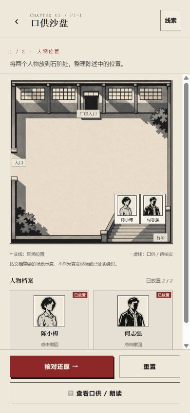
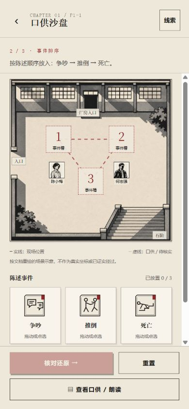
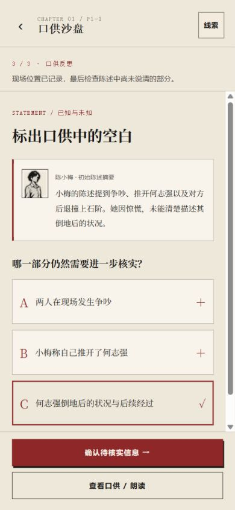
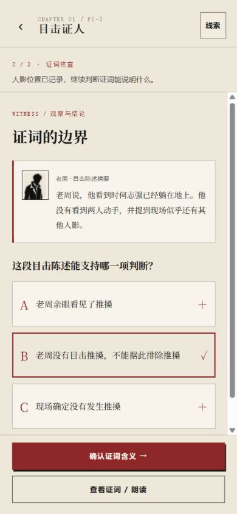

# 02 · 从玩法到交互

## 目标与问题
口供沙盘需要承载人物放置、事件排序及待核实信息；目击证人模块需要区分亲眼看到的内容与推断。旧 Demo 提前指向答案，且部分拖放标记的语义不清。

## 我的反馈所推动的调整
保留人物摆放与事件排序；把口供反思改为阅读摘要后选择尚未说清的情况。证词模块保留人影空间标记，将“未推搡”拖放改为证词含义判断，明确“未目击推搡”不能证明“未发生推搡”。

| 环节 | 修改目的 |
| --- | --- |
| 人物放置 → 事件排序 | 将口供内容转成可以操作的空间与顺序 |
| 摘要 → 选择 → 反馈 | 让玩家理解信息缺口，选错后可以重选 |
| 人影标记 → 证词判断 | 区分观察和结论，避免标记产生歧义 |

 

 

## 验证与边界
已有版本说明记录了人物摆放、事件排序、口供反思及证词判断的错误/正确反馈与结果核对。这里引用历史核对记录，不等于本仓库整理时重新执行了全部测试。

选择题与分步界面属于本次设计优化，不冒称原始剧本已有 UI，也不因此新增案件事实。来源：2026-11-03《更新说明-证词交互优化》。
