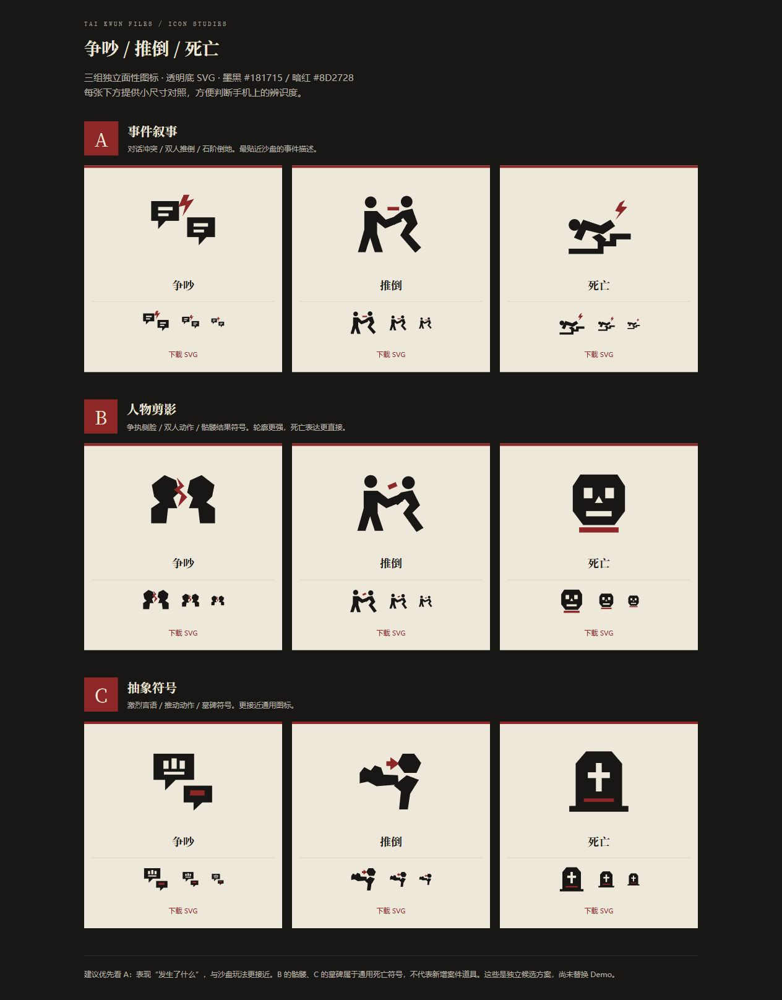
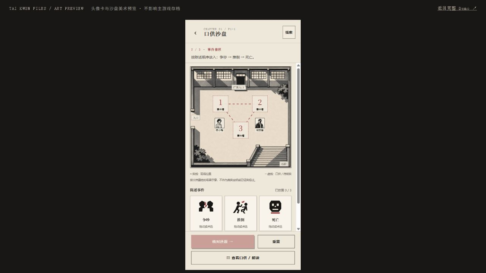

# 03 · 通过具体反馈调整视觉

## 目标
让争吵、推倒、死亡图标在手机卡片中易于辨认，并与项目整体美术一致。

## 方案探索
AI 辅助生成不同图标方向，我根据实际页面判断并选择参考。

## 我的实际反馈
> 我还是觉得这个 icon 很奇怪，和另外三个不是很和谐，你调整一下，让图形规整一点。

随后提供指定参考替换推倒图标，并提出放大 15% 的要求。反馈逐步落实为轮廓、肢体粗细、几何风格和显示比例的调整；要求卡片、拖动预览及放置结果同步更新。

## 结果与判断
图标不是孤立完成后就结束，需要放回真实卡片及不同交互状态中检查。上述图片为不同修改节点的记录，不是用户测试结果，也不代表图标已经证明提高理解率。

来源：聊天《拆解 UI 流程与交互控件》中图标选择、规整轮廓、指定参考与尺寸调整记录。
