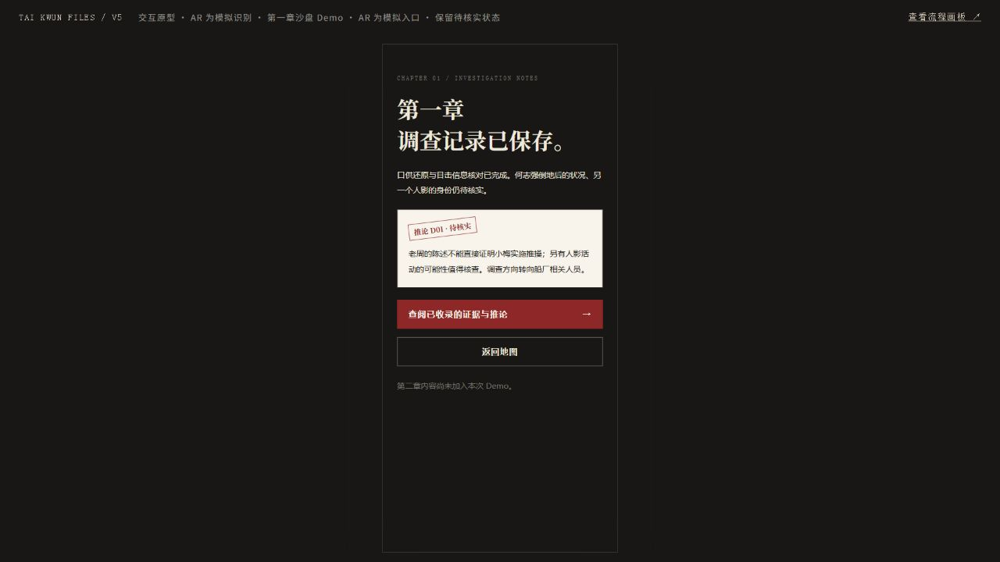

# 04 · 整合、检查与交付

## 目标
将两个独立模块接回原有 Demo，让后续技术对接有可查看、可运行的依据。

## 我的要求与修改过程
1. 将目击证人模块放入原有 Demo，核对入口、剧情与线索入档。
2. 发现地点说明残留旧版内容后修正；没有 AR 识别图时，使用现场剧情入口。
3. 发现推倒图标在浏览器中显示不出，要求检查并修复。实现中将 SVG 内嵌以减少文件引用问题。
4. 本地预览曾出现连接超时，随后恢复服务并提供直接打开的版本。
5. 要求将两个模块及其依赖单独打包，上传 GitHub 独立分支。

## 交付物
[第一章两个模块独立包](../deliverables/chapter-one-standalone.zip)：包含口供沙盘、目击证人及依赖素材。完整解压后打开 index.html。

历史交付记录显示已上传原项目分支；本仓库保留相应压缩包，便于作品集读者查看。未将压缩包中的全部代码逐文件展开成新的开发历史。

## 我的收获
对接能力体现在把体验问题描述成具体修改要求，并持续检查视觉、交互与运行方式是否满足交付需要。AI 辅助实现，需求选择与反馈判断是我的主要贡献。
