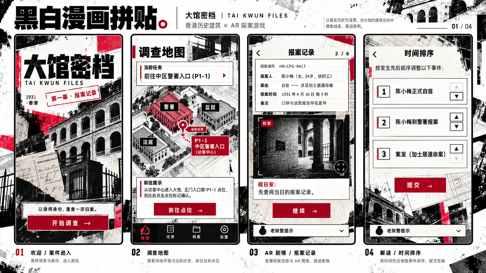
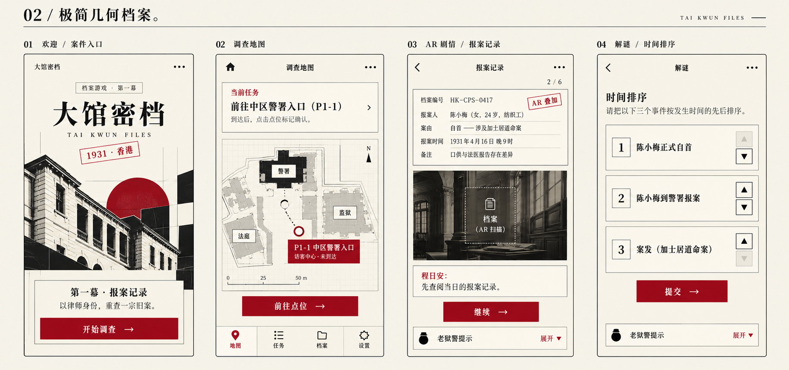
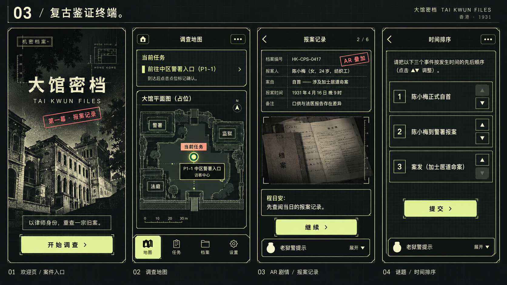
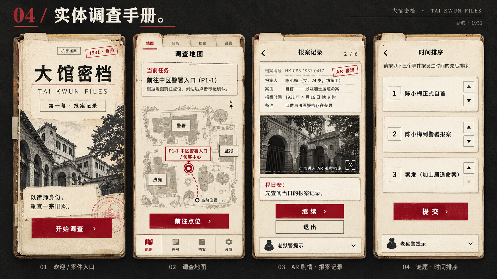

# 2026-10-13 · 流程拆解与四种视觉方向

> 回顾整理；日期来自聊天时间（Asia/Shanghai），不是本次 Git 提交时间。

## 当时的需求

提供原型视频、UI参考和项目美术 skill，要求拆解流程、交互与控件，再比较四种风格。

## 我的判断与贡献

我的工作是提供参考、限定比较对象并提出风格方向；AI 辅助拆解和生成概念稿。四套方案是风格探索，不是四个已经落地的产品。

## 流程与修改

从视频分析欢迎、引导、地图、扫描、剧情、排序、档案与设置的关系。随后围绕首页、地图、剧情、解谜四类页面探索黑白漫画拼贴、极简几何档案、复古鉴证终端、实体调查手册。场景 skill 用于美术一致性，不能代替 UI 交互规范。

## 对应产出

## 证据与边界

概念图中的案件年代、文字及地图不能视为正式内容。四套概念图文件现存。

依据：聊天《拆解 UI 流程与交互控件》当日用户需求、AI回复及现存本地产出。AI回复中的完成声明不自动等于已验证事实。文件校验信息见 [清单](../artifact-manifest.json)。
