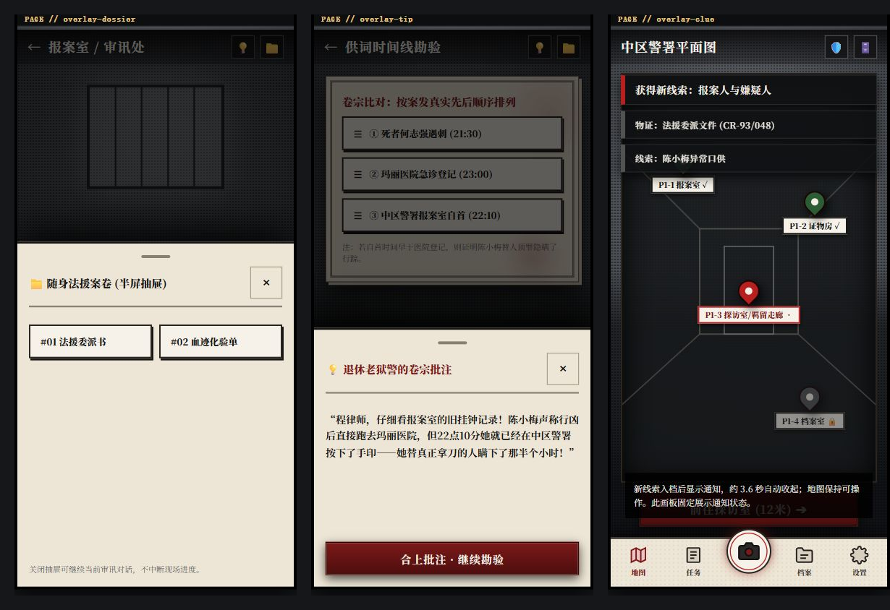
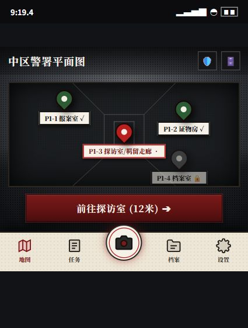
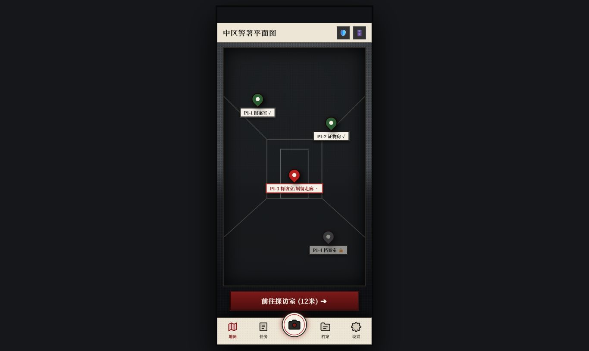

# 2026-10-14 · 浮层补齐、导入页与屏幕适配

> 回顾整理；日期来自聊天时间（Asia/Shanghai），不是本次 Git 提交时间。

## 当时的需求

要求运行已有 HTML，查找缺失 UI、补充浮层，并针对手机大小和电脑显示反复提出适配反馈。

## 我的判断与贡献

我的反馈从“页面不符合手机尺寸”推进到提供具体布局参考，同时提出打包分享需求，验收对象从单张视觉图转向可运行页面。

## 流程与修改

补充缺失浮层，完善案件导入页；分别检查手机和桌面下的画布布局。现存截图用于证明当时的页面形态，不能以文件修改日期代替聊天日期。

## 对应产出

- [interactive-preview.zip](../milestones/02/interactive-preview.zip)

## 证据与边界

早期持续覆盖更新，不保证每一轮浮层和适配都有独立快照。现存包作为历史留存，不宣称是当天结束时的逐字节版本。

依据：聊天《拆解 UI 流程与交互控件》当日用户需求、AI回复及现存本地产出。AI回复中的完成声明不自动等于已验证事实。文件校验信息见 [清单](../artifact-manifest.json)。
