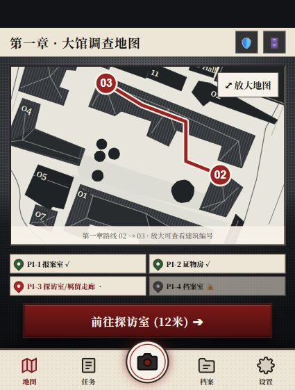
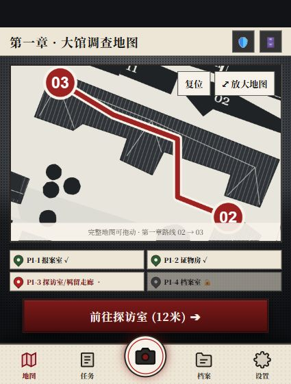
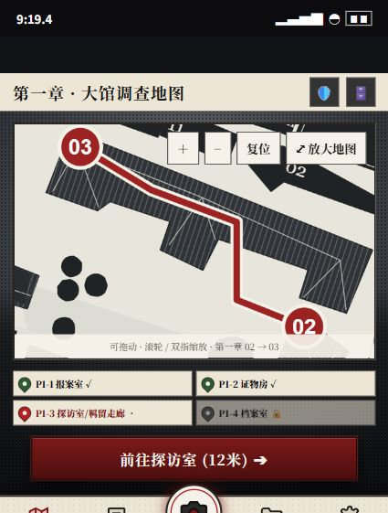

# 2026-10-15 · 地图素材接入、铺满、拖动与缩放

> 回顾整理；日期来自聊天时间（Asia/Shanghai），不是本次 Git 提交时间。

## 当时的需求

提供项目地图和第一部分点位，要求保留 UI 风格与可读性，并逐步明确整张地图的浏览方式。

## 我的判断与贡献

我区分了“铺满容器”“拖动局部”“拖动整张地图”和“缩放地图”，将模糊的适配要求转成具体交互要求。

## 流程与修改

原始地图接入 → 第一章范围 → 地图适配容器 → 整图拖动 → 缩放浏览。最后提出导入 Figma 的需求；提出导入不等于已有成功导入证明。

## 对应产出

- [map-filled.zip](../milestones/03/map-filled.zip)
- [map-zoom-pan.zip](../milestones/03/map-zoom-pan.zip)

## 证据与边界

截图与压缩包为现存历史产出；未用当前页面重建修改前的版本。

依据：聊天《拆解 UI 流程与交互控件》当日用户需求、AI回复及现存本地产出。AI回复中的完成声明不自动等于已验证事实。文件校验信息见 [清单](../artifact-manifest.json)。
