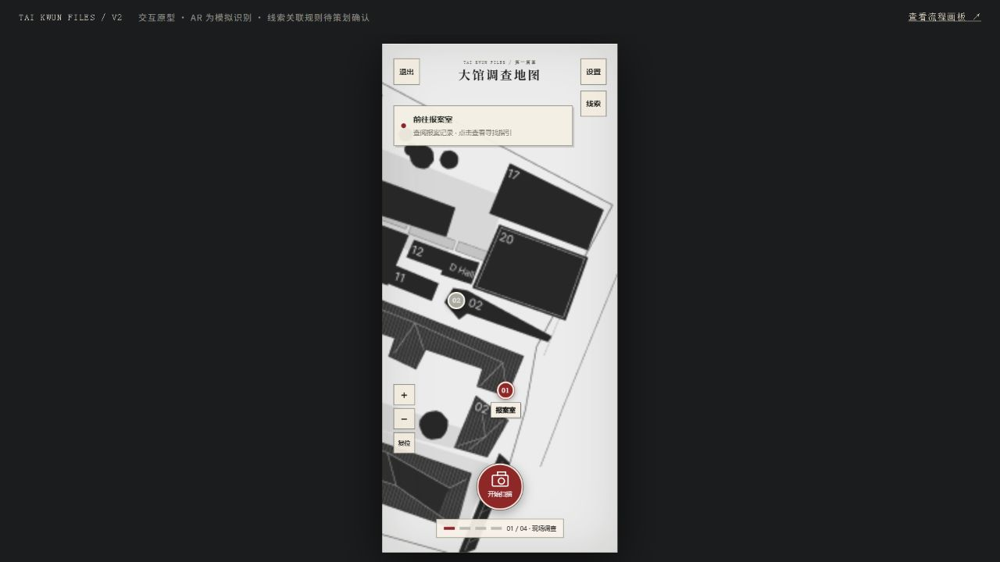
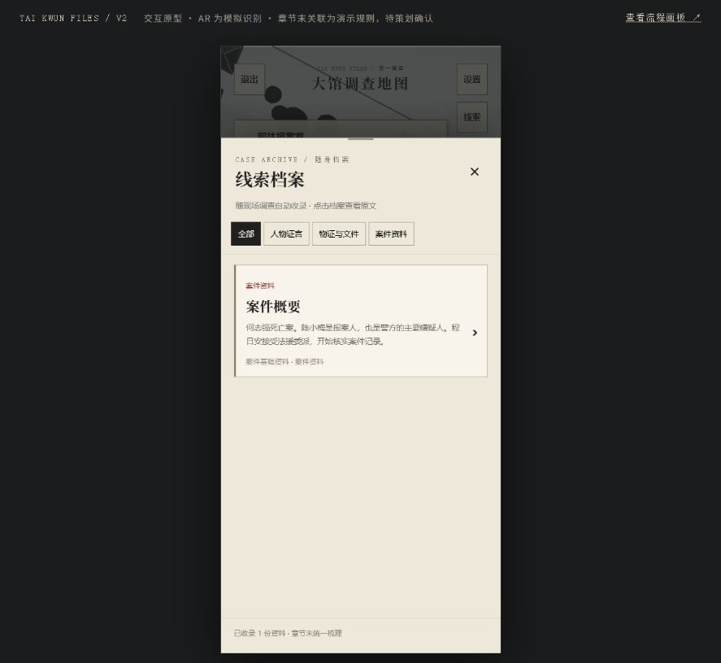
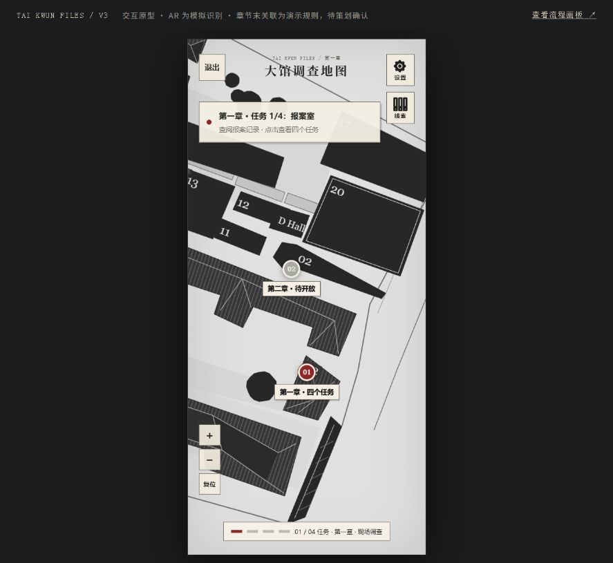
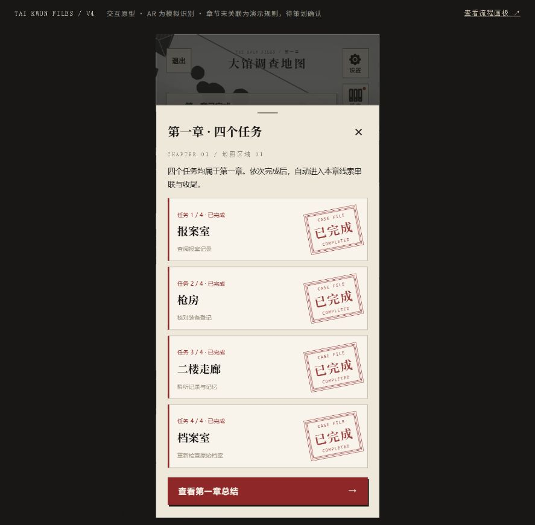

# 2026-10-28 · 地图核心流程重构与策划反馈

> 回顾整理；日期来自聊天时间（Asia/Shanghai），不是本次 Git 提交时间。

## 当时的需求

从技术分享的 MVP 工程出发，要求浏览器运行与全页面平铺；随后明确以地图为核心的推进方式，并吸收策划对入口分工的建议。

## 我的判断与贡献

我指出证言与物证混排、串联动机不清，要求日常线索恢复分类档案抽屉；澄清章节与任务的层级；整合策划建议，分离任务清单、地点指引和扫描入口。

## 流程与修改

地图 → 地点指引 → 扫描 → 剧情与基础解谜 → 收录线索 → 返回地图。顶部任务卡查任务，地图标记找位置，地点详情开启扫描。移除首页重复相机入口。纠正偏绿配色，指定红色 #8D2728、黑色 #181715；要求完成状态采用印章。当天还要求分享包和技术仓库独立分支交付。

## 对应产出

- [map-v2-retained.zip](../milestones/05/map-v2-retained.zip)
- [map-v4.zip](../milestones/05/map-v4.zip)
- [map-v4-1-share.zip](../milestones/05/map-v4-1-share.zip)

## 证据与边界

V2/V3 期间存在覆盖，压缩包只是现存留存。章节末自动串联曾是方案，10月29日因缺少正式内容而暂停，不能作为当前完成能力。

依据：聊天《拆解 UI 流程与交互控件》当日用户需求、AI回复及现存本地产出。AI回复中的完成声明不自动等于已验证事实。文件校验信息见 [清单](../artifact-manifest.json)。
