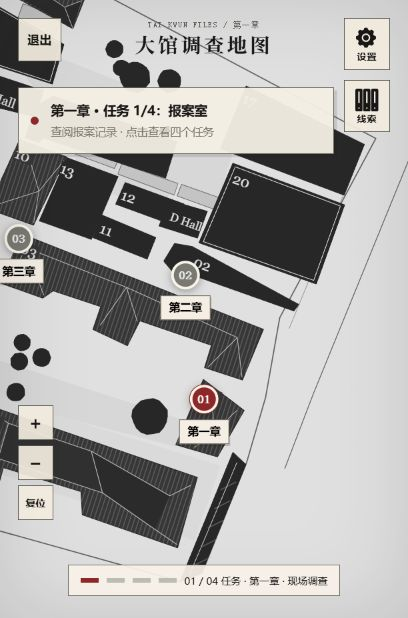
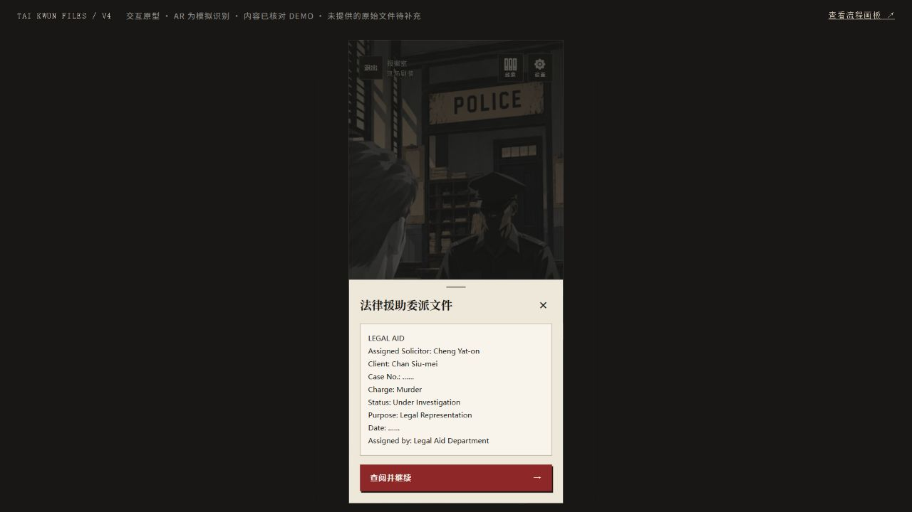

# 2026-10-29 · 技术交接、小程序适配与内容核对

> 回顾整理；日期来自聊天时间（Asia/Shanghai），不是本次 Git 提交时间。

## 当时的需求

回应技术下载仍像旧版的问题，要求核对下载包；随后提出微信小程序适配，并按策划文档删除虚构内容。

## 我的判断与贡献

我的工作不仅是改页面，还包括澄清网页原型与小程序工程的交付区别，并要求以正式资料校验 AI 生成内容。

## 流程与修改

核对下载包 → 识别网页目录与小程序根目录的区别 → 原生工程适配 V4.2 → 依据 DEMO 文档修订 V4.3。删除无依据年代、时间线与奖励；保留有文档依据的内容；缺少任务四全文和章节规则时暂停结算。

## 对应产出

## 证据与边界

历史说明仅确认静态检查；未取得微信编译与真机验收证据。原生包可能包含原项目配置，仅列入本地证据清单，不公开复制；避免把技术工程和第三方素材整包公开。公开网页图中的文字也不作为新增案件依据。

依据：聊天《拆解 UI 流程与交互控件》当日用户需求、AI回复及现存本地产出。AI回复中的完成声明不自动等于已验证事实。文件校验信息见 [清单](../artifact-manifest.json)。
