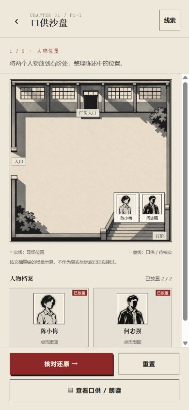
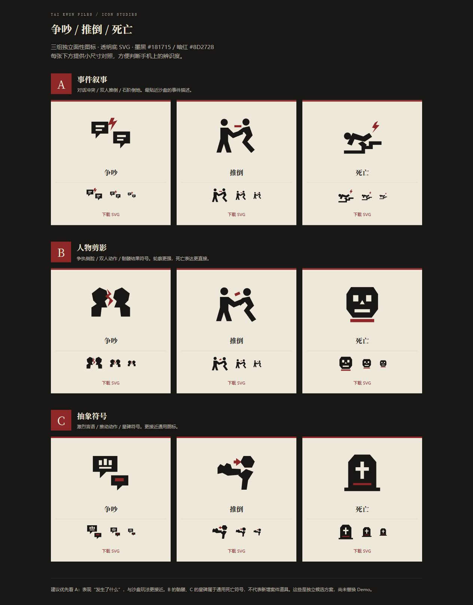
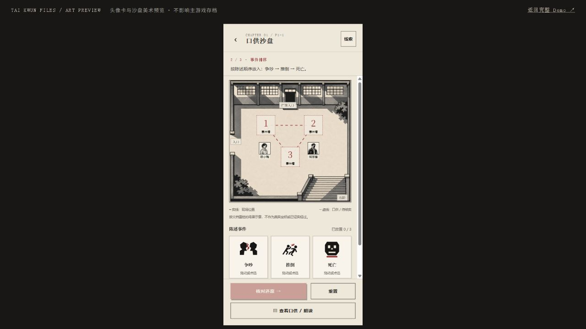
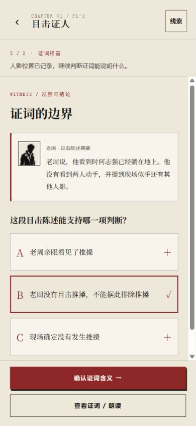

# 2026-11-03—2026-11-04 · 第一章玩法、美术和最终模块交付

> 回顾整理；日期来自聊天时间（Asia/Shanghai），不是本次 Git 提交时间。

## 当时的需求

依据新文档加入第一章玩法，接入项目美术；指定人物大头照作为拖拽对象，并反复校验交互含义、图标风格和页面运行。

## 我的判断与贡献

我要求核对原文，指出问号和“未推搡”操作含义不清；提供自己画的草图作为争吵、推倒参考，指定动作与棱角要求，继续调整比例和状态一致性。

## 流程与修改

文档需求 → 沙盘玩法 → 美术适配 → 口供反思/证词判断优化 → 图标多方案与草图反馈 → 接回主 Demo → 修复 SVG 和预览问题 → 两模块独立打包并交付。人物与事件操作保留；“未目击推搡”不等于“未发生推搡”。

## 对应产出

- [chapter-one-review.zip](../milestones/07/chapter-one-review.zip)
- [chapter-one-standalone.zip](../milestones/07/chapter-one-standalone.zip)

## 证据与边界

依据聊天日期，11月3日晚开始图标草图优化，11月4日继续替换、尺寸调整与交付。未把历史静态检查或浏览器核对写成真实 AR/真机验收。

依据：聊天《拆解 UI 流程与交互控件》当日用户需求、AI回复及现存本地产出。AI回复中的完成声明不自动等于已验证事实。文件校验信息见 [清单](../artifact-manifest.json)。
